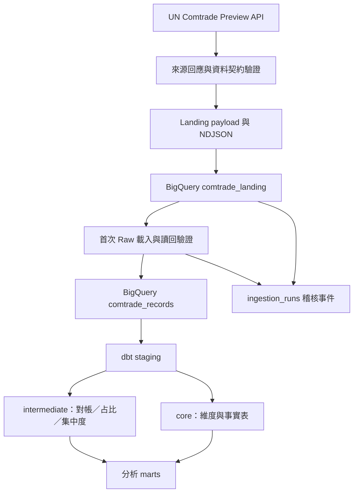

# 系統架構

[回到首頁](../README.md)

## 資料流

Raw source 位於 `trade_raw`；本機開發 dbt 輸出位於 `trade_analytics_dev`。上圖表示主要依賴，個別模型的精確依賴以 SQL 的 `ref()` 為準。

## 模組責任

| 子系統 | 責任 |
|---|---|
| `ingestion` | 查詢參數、HTTP client／重試、來源擷取及批次結果 |
| `contracts` | Query identity、唯一粒度、精度、Raw scope、來源完整性驗證 |
| `processing` | 將資料轉成 Landing 欄位及 NDJSON；保留來源 JSON |
| `warehouse` | 資料表初始化、Landing load、Raw initial load、稽核及復原 |
| `orchestration.runner` | 驗證本機路徑，以子程序串接既有 ingestion 與 dbt |
| `dags` | 手動編排 Runner，不另外建立 batch identity |
| `dbt` | Staging／intermediate views、core／marts tables 與品質測試 |

## 執行邊界

`main.py` 的批次擷取與 manifest 驗證不等同正式入庫。完整 CLI 路徑為 Runner → `production_smoke` → Landing coordinator → Raw coordinator；Airflow 再將 ingestion 與 dbt build 串接。

HTTP 層可重試暫時性請求失敗；這不代表可自動重試整個 ingestion。來源每次可能改變，CLI 也會產生新的 batch ID，因此 Raw 不明狀態應查詢原 Job，而非重新擷取再寫入。

Landing、Raw 與稽核事件並非單一跨階段交易。可能出現 Landing 成功但 Raw 失敗、Raw 成功但最終 audit 寫入失敗。以 Job 狀態及 Raw 讀回驗證共同判斷，不能只讀最後一行日誌。

## 模型與演進限制

Staging 分開 World Total 與 Partner Detail。Core 包含 `dim_period`、`dim_reporter`、`dim_partner`、`dim_commodity` 與 `fct_trade_imports`；四個 Mart 提供趨勢、夥伴占比、商品排名及集中度。

目前不提供來源完整性保證、歷史修訂替換、自動 backfill、正式 Airflow 部署或自動復原 CLI。未來若調整 scope、key 或 Raw schema，需同時更新 Python contracts、BigQuery schema、dbt 模型與測試，並先設計既有資料遷移，不能只修改新資料的轉換程式。
